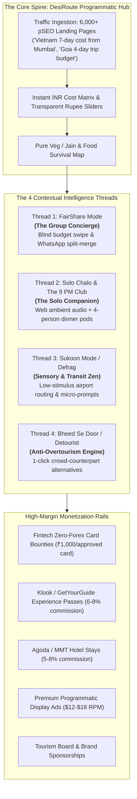
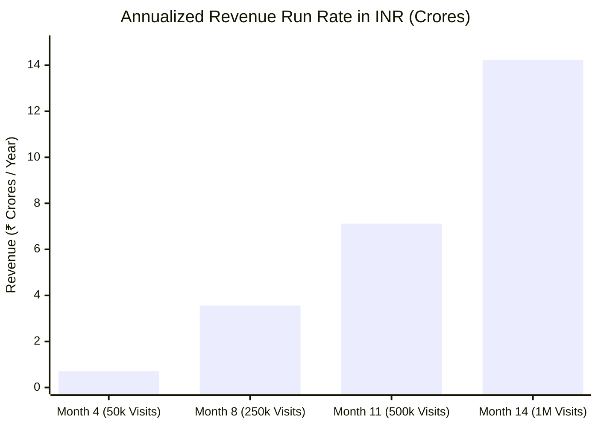
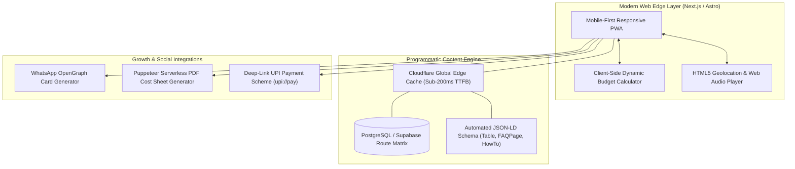
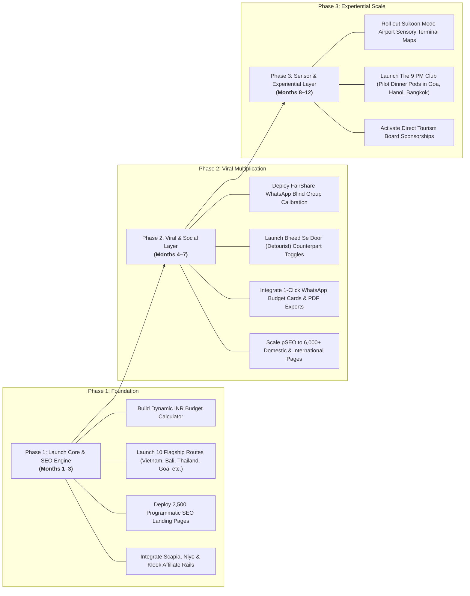

# DesiRoute OS: The Unified Travel Masterpiece
**Roles:** Head of Marketing & Senior Business Analyst  
**Strategic Document:** Merged Vision, System Architecture & Financial Model  
**Target:** Executive Leadership, Product Engineering, Growth & Monetization  
**Platform:** 100% Web-First (Zero App Barrier, Universal Browser & WhatsApp Compatibility)  
**Target Audience:** Indian Domestic & Outbound Travelers (Price, Culture, Diet, and Comfort Sensitive)  

---

## 1. Executive Vision: Weaving the 5 Threads into One Tapestry

When building a high-growth travel business for the Indian market, feature bloat kills platforms, but **fragmentation kills travelers.** 

Instead of building 5 separate disconnected apps or niche utilities, we weave the 5 core strategic pillars into **one seamless, stateful Web Operating System: "DesiRoute OS"**.



### The Architectural Analogy: A "Smart Lens" over the Itinerary
Rather than burdening the user with menus and settings, the platform operates like a **smart contextual lens**:
1. When a user is planning a group trip with college friends or cousins $\to$ **FairShare Mode** automatically activates.
2. When a traveler is flying solo to Bali or exploring Varanasi alone $\to$ **The 9 PM Club & Audio Walk** activates.
3. When stepping into a chaotic terminal (IGI Delhi, CSMIA Mumbai, or Bangkok Suvarnabhumi) $\to$ **Sukoon (Defrag) Mode** guides their nervous system.
4. When facing 2-hour queues at crowded tourist traps $\to$ **Bheed Se Door (Detourist)** suggests peaceful, authentic cultural counterparts with 1 tap.

All of this happens **inside the browser, with zero login, zero app download, and zero friction.**

---

## 2. Deep Dive: How the 4 Threads are Woven into the Web Platform

```
  ┌────────────────────────────────────────────────────────────────────────┐
  │                 DESIROUTE CONTEXTUAL ARCHITECTURE                      │
  ├────────────────────────────────────────────────────────────────────────┤
  │                                                                        │
  │   [Origin: Delhi] ──▶ [Destination: Vietnam] ──▶ [Duration: 6 Days]    │
  │                                                                        │
  │   ┌───────────────────────────┬───────────────────────────┐            │
  │   │  TRIP TYPE TOGGLE         │  EXPERIENCE TOGGLE        │            │
  │   │  🔘 Group / Friends       │  🔘 Sukoon (Low Sensory)  │            │
  │   │  🔘 Solo Explorer         │  🔘 Bheed Se Door (Detour)│            │
  │   └───────────────────────────┴───────────────────────────┘            │
  │                                                                        │
  │   ▼ DYNAMIC WEB OUTPUT                                                 │
  │   ├─ INR Budget Matrix + Pure Veg / Jain Dining Pins                   │
  │   ├─ Thread 1 (FairShare): WhatsApp Blind Budget Sync & Split Ledger   │
  │   ├─ Thread 2 (The 9 PM Club): Ambient Audio Stream & Dinner Table Pods│
  │   ├─ Thread 3 (Sukoon/Defrag): Calm Terminal Walkthrough & Quiet Gates │
  │   └─ Thread 4 (Detourist): Crowd Bypass & Counterpart Swaps            │
  │                                                                        │
  └────────────────────────────────────────────────────────────────────────┘
```

---

### Thread 1: FairShare Mode (The Group Peacekeeper)
* **The Problem:** Group trips (Goa, Ladakh, Thailand, Bali) are notorious for causing interpersonal fallout due to the "Trip Mom" doing all the work, mismatched budgets, and chasing payments.
* **How It Weaves into DesiRoute Web:**
  1. **The WhatsApp Calibration Invite:** The trip organizer clicks **"Sync with Group on WhatsApp"**. A lightweight web link is generated: `desiroute.com/sync/goa-friends-xyz`.
  2. **Zero-App Blind Swipe Survey:** Each friend opens the link in mobile Safari/Chrome (no login needed). In 45 seconds, they privately answer 4 Tinder-style cards:
     - *Max budget ceiling in ₹ (e.g. ₹35,000 vs ₹60,000).*
     - *Wake-up style: Early bird (8 AM) vs Vacation sleeper (11:30 AM).*
     - *Pace: Fast-paced sightseer vs Cafe lounger.*
     - *Dietary: Strict Veg/Jain vs Non-Veg.*
  3. **Automated Split-and-Merge Schedule:** The web engine aggregates responses and crafts an itinerary that **normalizes splitting up**:
     - *Day 3 (10 AM - 3 PM):* Friends A & B get a scuba diving pass (Klook affiliate); Friends C & D get a beachfront cafe recommendations (high-dwell ad impression).
     - *Day 3 (7:30 PM):* Group merges at an Indian-friendly sunset restaurant.
  4. **Embedded UPI / Rupee Ledger:** At the bottom of the itinerary, an automated expense settlement tool calculates who paid for flights or villa stays and displays direct UPI payment links (`upi://pay?...`), eliminating debt resentment.

---

### Thread 2: Solo Chalo & The 9 PM Club (Solo Exploration with Community Safety)
* **The Problem:** Solo travelers value daytime autonomy, but 35% experience a severe loneliness drop at 8:30–9:30 PM during sit-down dinners in unfamiliar cities.
* **How It Weaves into DesiRoute Web:**
  1. **Daytime Ambient Web Audio Guides (No App Required):**
     - Using standard HTML5 Geolocation and Web Audio APIs, the user taps "Listen to this Street" as they wander Old Quarter Hanoi, Galle Fort Sri Lanka, or Fort Kochi.
     - Streams 3-minute, high-production cultural stories narrated by local Indian expats, historians, and chefs directly through their browser into AirPods.
  2. **The "Table of 4" Desi Dinner Pods:**
     - At 4 PM every day, solo Indian travelers in popular hub destinations (e.g., Bangkok, Da Nang, Ubud, South Goa, Kasol) can opt into an open dinner pod at a vetted partner restaurant.
     - The web app matches 4 verified solo travelers at a table reservation at 8:30 PM.
     - An in-browser conversational prompt card ("What's the weirdest thing you packed?") eliminates awkward small talk.
     - Dinner bill is split evenly in ₹ on the phone; travelers can leave with zero lingering obligations.

---

### Thread 3: Sukoon Mode (Neuro-Inclusive Transit & Low-Stress Guidance)
* **The Problem:** Chaotic airports, confusing international visa lines, screaming crowds, and executive dysfunction make transit days pure torture for neurodivergent (ADHD/Autism) and anxious Indian travelers.
* **How It Weaves into DesiRoute Web:**
  1. **1-Tap "Sukoon Mode" Toggle:** Turning this switch re-skins the entire itinerary from a busy list into a **single-step, low-dopamine executive prompt**:
     - *"Right now: Have passport in hand and boarding pass downloaded. Walk toward Security Line B."*
  2. **Calm Terminal Maps & "Find My Sanctuary":**
     - Interactive SVG web maps for major airports (Delhi T3, Mumbai T2, Bangalore T2, Singapore Changi, Bangkok Suvarnabhumi, Dubai T3).
     - Pinpoints the exact low-decibel quiet zones, meditation/sensory rooms, clean washrooms, and empty boarding gates.
  3. **Visual Security Walkthrough:** Short 5-second looping GIF/WebP visual previews showing exactly what to remove at security scanners (electronics, belts, liquids) so users never feel rushed or publicly embarrassed.

---

### Thread 4: Bheed Se Door / Detourist (The Anti-Overtourism Engine)
* **The Problem:** Viral social media reels have ruined destinations. Travelers arrive at Baga Beach, Rohtang Pass, or Amalfi/Santorini only to get trapped in bumper-to-bumper traffic and inflated tourist prices.
* **How It Weaves into DesiRoute Web:**
  1. **The "UnCrowd Counterpart" Toggle:** Next to every famous crowded attraction, DesiRoute offers a 1-click alternative:
     - *Instead of:* Baga Beach / Calangute (Goa) $\to$ *Detourist Suggests:* Ashwem or Cola Beach (40% less crowded, pristine sunsets).
     - *Instead of:* Golden Bridge / Ba Na Hills (Da Nang) at 11 AM $\to$ *Detourist Suggests:* Marble Mountains sunrise or Hai Van Pass coast road.
     - *Instead of:* Overpriced tourist traps $\to$ *Detourist Suggests:* Local family-run cafes with pure vegetarian accommodations.
  2. **Dynamic Route Dispersal Bounties:** Tourism boards (e.g., Vietnam, Thailand, regional Indian states like Madhya Pradesh and Meghalaya) sponsor these alternative routes to distribute tourist spend into secondary towns.

---

## 3. Financial Engineering: Comprehensive Monetization & APR/Yield Model

To calculate the exact revenue potential, we establish our **Blended Yield Model**.

In digital media and programmatic platforms:
* **RPM (Revenue Per Mille):** Revenue generated per 1,000 pageviews.
* **Affiliate Yield / EPC (Earnings Per Click):** Revenue generated per outbound conversion.
* **Blended ARPU (Annual Average Revenue Per Active User):** Total annualized platform income divided by unique users.

```
  ┌────────────────────────────────────────────────────────────────────────┐
  │                    THE 5 MONETIZATION ENGINES                          │
  ├───────────────────────────────────┬────────────────────────────────────┤
  │ 1. High-Ticket Fintech Bounties   │ ₹800 – ₹1,500 per approved card    │
  │ 2. Travel & Activity Affiliates   │ 5% – 8% commission (Klook/Agoda)   │
  │ 3. Connectivity & Insurance       │ 15% – 25% recurring margin         │
  │ 4. Programmatic Display Ads       │ $12 – $18 RPM on high-intent pages │
  │ 5. B2B / B2G Sponsorships         │ ₹2,50,000 – ₹10,00,000 per deal    │
  └───────────────────────────────────┴────────────────────────────────────┘
```

---

### 3.1 Monetization Stream Deep Dive & Unit Economics

#### Engine 1: High-Ticket Fintech Cards (The Outbound Goldmine)
* **Context:** Indian travelers lose 3.5% to 5% in foreign exchange markups + 18% GST when using regular bank cards abroad.
* **The Offer:** Integrated directly into the budget calculator: *"Save ₹5,500 on currency markup on this trip: Get a Zero-Forex Card (Scapia / Niyo / Fi) with zero annual fee."*
* **Metrics:**
  - Payout per approved card: **₹1,000** (average across affiliate networks like vCommission, EarnKaro, bank direct).
  - Outbound traffic intent: 60% of total searches.
  - Conversion rate (Click-to-approval): **1.2%** of outbound visitors.
  - **Yield per 1,000 Outbound Visitors:** $1,000 \times 0.60 \times 0.012 \times ₹1,000 = \mathbf{₹7,200\text{ (\$86.70)}}$.

#### Engine 2: Tour, Activity & Stay Affiliates (Klook, Agoda, MakeMyTrip)
* **The Offer:** Day-by-day itinerary entries link directly to verified activity tickets (e.g. Ba Na Hills cable car, Phi Phi speedboat, Burj Khalifa 124th floor, Scuba in North Goa).
* **Metrics:**
  - Average booking cart: ₹7,500 per couple.
  - Commission rate: **6.5%** (₹487 per transaction).
  - Click-through-rate (CTR) to booking: 4.5%.
  - Booking conversion: 3.0%.
  - **Yield per 1,000 Visitors:** $1,000 \times 0.045 \times 0.03 \times ₹487 = \mathbf{₹657\text{ (\$7.90)}}$.

#### Engine 3: Connectivity & Travel Insurance (eSIM + PolicyBazaar)
* **The Offer:** 1-click Airalo / Nomad eSIM discount code + Schengen / international medical insurance comparison.
* **Metrics:**
  - eSIM commission: 20% on $15 average pack = $3.00 (₹250).
  - Insurance bounty: ₹300 per policy.
  - Blended conversion: 0.8% of outbound visitors.
  - **Yield per 1,000 Visitors:** $1,000 \times 0.008 \times ₹275 = \mathbf{₹220\text{ (\$2.65)}}$.

#### Engine 4: Programmatic Display Advertising (Mediavine / Raptive / AdSense)
* **The Offer:** Non-intrusive, lightning-fast sticky ad placements flanking the interactive budget calculator and itinerary steps.
* **Metrics:**
  - High commercial intent (travel, flights, hotel, credit card categories have the highest ad bids globally).
  - Average Blended Travel RPM (India + Outbound mix): **$14.00 per 1,000 Pageviews** ($\approx \mathbf{₹1,160}$).
  - Average pageviews per user session (interacting with sliders and itinerary tabs): **2.4 pages/session**.
  - **Yield per 1,000 Visitors:** $2.4 \times ₹1,160 = \mathbf{₹2,784\text{ (\$33.50)}}$.

---

### 3.2 Total Blended Yield & Pageview Value Calculation

Adding all revenue streams together gives our **Gross Yield per 1,000 Unique Visitors (eCPM / RPM Equivalent)**:

$$\begin{aligned}
\text{Total Yield / 1,000 Visitors} &= \text{Fintech (₹7,200)} + \text{Affiliates (₹657)} + \text{Connectivity (₹220)} + \text{Display Ads (₹2,784)} \\
&= \mathbf{₹11,861\text{ per 1,000 Unique Visitors}} \\
&= \mathbf{₹11.86\text{ Average Revenue Per Unique Visitor (ARPU)}}
\end{aligned}$$

*Note: In US Dollar terms, this translates to an extraordinarily high **$142.90 Gross Blended RPM per 1,000 unique visitors**, driven primarily by high-ticket fintech card conversions.*

---

### 3.3 Annualized Revenue Projections (14-Month Scale)



| Scale Milestone | Monthly Unique Visitors | Monthly Pageviews | Monthly Gross Revenue (₹) | Monthly Gross Revenue (USD) | **Annualized Run Rate (₹)** |
| :--- | :--- | :--- | :--- | :--- | :--- |
| **Phase 1: Seed (Mo 4)** | 50,000 | 120,000 | ₹5,93,000 | ~$7,150 | **₹71.1 Lakhs (~$85,000)** |
| **Phase 2: Scale (Mo 8)** | 250,000 | 600,000 | ₹29,65,000 | ~$35,700 | **₹3.56 Crores (~$430,000)** |
| **Phase 3: Mature (Mo 11)**| 500,000 | 1,200,000 | ₹59,30,000 | ~$71,400 | **₹7.12 Crores (~$860,000)** |
| **Phase 4: Leader (Mo 14)**| 1,000,000 | 2,400,000 | ₹1,18,61,000 | ~$142,900 | **₹14.23 Crores (~$1.71 Million)** |

*Assumptions: Organic programmatic SEO compounding with zero paid CAC; WhatsApp referral coefficient $K = 0.35$; 60/40 outbound/domestic traffic split.*

---

## 4. Implementation Strategy & Technical Architecture

### 4.1 System & Tech Stack Blueprint (Web-Only, High Performance)



#### Why This Stack Wins:
1. **Sub-200ms Initial Load (Core Web Vitals Perfection):** Static generation (SSG) with dynamic edge hydration ensures Google ranks every page at the top of search results.
2. **No Backend Database Calls for Visitors:** Calculations run instantaneously in the browser via lightweight JavaScript.
3. **Zero App Store Taxes:** 0% commission paid to Apple or Google; 100% of affiliate revenue and ad income is retained.

---

### 4.2 Three-Phase Implementation Roadmap



---

## 5. Execution Summary: The Masterpiece in One Sentence

**DesiRoute OS** takes the unaddressed psychological pains of the modern traveler—*group tension, solo isolation, sensory exhaustion, and overtouristed misery*—and solves them through an **instant, zero-app, programmatic web calculator** that converts high-intent Google searchers into multi-crore affiliate and ad revenues.
