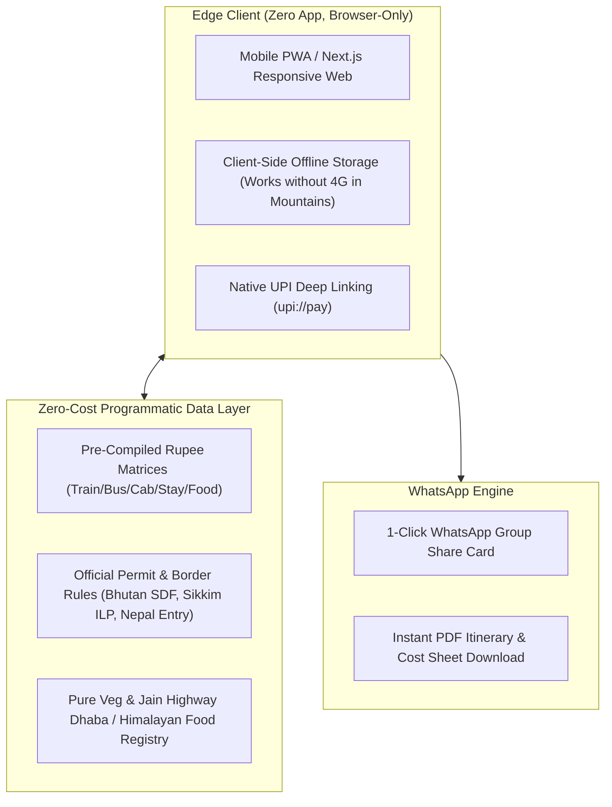
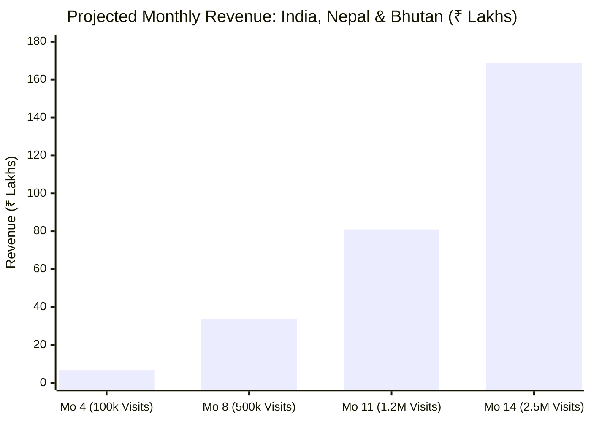
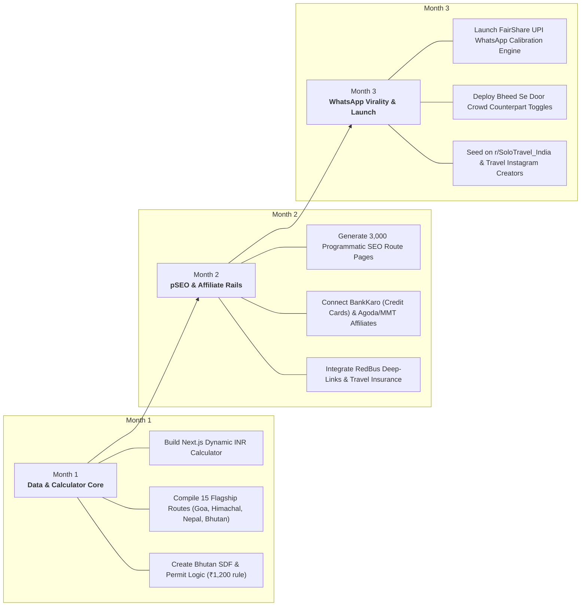

# DesiRoute Subcontinent: India, Nepal & Bhutan Master Strategy
**Roles:** Head of Marketing & Senior Business Analyst  
**Focus Territory:** Strictly India (Domestic) + Nepal + Bhutan (Zero Outbound Western/ASEAN)  
**Platform:** 100% Mobile Responsive Web Application (No App Required)  
**Core Thesis:** Hyper-localized, high-volume travel utility solving permits, transit chaos, pure-veg dining, and overtourism with native UPI and domestic affiliate monetization.

---

## 1. The Strategic Opportunity: The "Subcontinent Triangle"

Narrowing focus exclusively to **India, Nepal, and Bhutan** transforms DesiRoute from a generic travel tool into an **unrivaled regional monopoly**. 

```
  ┌────────────────────────────────────────────────────────────────────────┐
  │                   THE SUBCONTINENT TRAVEL REALITY                      │
  ├────────────────────────────────────────────────────────────────────────┤
  │ India Domestic: 1.8+ Billion domestic leisure and pilgrimage trips/yr  │
  │ Nepal Corridor: ~1 Million Indian visitors (No passport/visa required) │
  │ Bhutan Corridor: Top high-spending cultural destination for Indians    │
  │                  (Subsidized SDF ₹1,200/night vs $100 for foreigners)  │
  └────────────────────────────────────────────────────────────────────────┘
```

### Why This Triangle is an Unbeatable Niche:
1. **Zero Visa Barriers for Indians:**
   - *India Domestic:* Free movement.
   - *Nepal:* Voter ID or Passport is sufficient; Indian Rupee (INR ₹100 notes) accepted everywhere.
   - *Bhutan:* Subsidized Entry Permit for Indians (requires Voter ID/Passport); INR is pegged 1:1 with Bhutanese Ngultrum (BTN).
2. **Extreme Information Asymmetry & Confusion:**
   - **Bhutan Permit & SDF Rules:** Confusion about the ₹1,200 Sustainable Development Fee (SDF), mandatory certified local guides, vehicle entry permits at Phuentsholing/Samdrup Jongkhar, and Paro flight pricing.
   - **Nepal Transit & Currency Cartels:** Border crossing hassles (Sunauli/Gorakhpur, Raxaul), fake taxi agents, the ban on ₹500 Indian notes, and local SIM setup.
   - **India Domestic Chaos:** Manali/Goa taxi union cartels, IRCTC Tatkal train ticket waitlists, altitude sickness in Ladakh/Spiti, and Kedarnath/Varanasi overcrowding.
3. **Massive Search Volume:**
   - Searches for domestic and Himalayan routes are **15x larger** than outbound European/ASEAN searches.

---

## 2. Feasibility Approach (100% Web Architecture)



### 2.1 Technical Feasibility (Handling Poor Himalayan Connectivity)
* **The Constraint:** Travelers in Spiti, Ladakh, Bhutan valleys, or Nepal trails face spotty 2G/3G connectivity.
* **The Solution:** 
  1. **Offline-First PWA (Progressive Web App):** Once a user loads an itinerary (e.g. `desiroute.com/r/delhi-kathmandu-7d`), the entire budget, offline contact numbers, pure-veg map pins, and permit steps are cached in local browser storage via Service Workers.
  2. **Sub-150ms Load Times:** Built on Next.js / Astro static generation on Cloudflare edge servers located in Mumbai, Delhi, and Kolkata.
  3. **Zero App Store Overhead:** No 30% Apple/Google cut, no app review delays, works on every Android phone and iPhone.

### 2.2 Operational & Data Feasibility (Zero Heavy APIs)
* **No Expensive Live APIs Required:** We do not need live GDS flight feeds or dynamic taxi meter APIs to start.
* **Route Matrices:** Travel costs in India, Nepal, and Bhutan follow predictable seasonal brackets (Low, Mid, Peak). We pre-compile:
  - Bus routes (HRTC, UPSRTC, private Volvo sleepers via RedBus).
  - Train benchmarks (3AC / 2AC / Sleeper Tatkal fares).
  - Fixed-rate shared cabs (e.g., Siliguri to Gangtok/Jaigaon, Gorakhpur to Sunauli/Pokhara).
  - Bhutan SDF and hotel rules directly mapped from the official Department of Tourism Bhutan guidelines.

### 2.3 Legal & Border Compliance Engine
* An automated interactive checklist for:
  - **Bhutan:** Verifying required documents (Passport with 6 months validity or Voter ID card), calculating exact SDF (Days $\times$ ₹1,200), mandatory guide booking, and child discounts.
  - **Nepal:** Accepted Indian photo IDs, driving permit procedures for Indian vehicles at the border, and local currency rules.
  - **India Protected Areas:** Inner Line Permits (ILP) for Ladakh, Sikkim, Arunachal Pradesh, and Andaman Islands.

---

## 3. Monetization Approach: Domestic & Subcontinent Engine

Because we are focusing strictly on India, Nepal, and Bhutan, we replace international forex cards with **India's highest-converting financial, travel, and activity affiliate programs.**

```
  ┌────────────────────────────────────────────────────────────────────────┐
  │                 SUBCONTINENT MONETIZATION STACK                        │
  ├───────────────────────────────────┬────────────────────────────────────┤
  │ 1. Indian Travel Credit Cards     │ ₹1,000 – ₹2,500 per approved lead  │
  │ 2. Stays (MakeMyTrip, Agoda, OYO) │ 4% – 8% commission on bookings     │
  │ 3. Bus & Transport (RedBus)       │ ₹30 – ₹60 per booked seat          │
  │ 4. Adventure Activities (Klook)   │ 6% – 10% on river rafting/paraglide│
  │ 5. High-Altitude & Travel Protect │ ₹200 – ₹450 per policy             │
  │ 6. High-Volume Display Ads        │ ₹250 – ₹600 CPM/RPM on travel pSEO │
  │ 7. Bhutan & State Tourism Boards  │ Sponsored regional itineraries     │
  └───────────────────────────────────┴────────────────────────────────────┘
```

---

### 3.1 Monetization Streams Breakdown

#### 1. Premium Travel Credit Card Referrals (Highest Single Payout)
* **The Hook:** *"How to travel to Bhutan, Goa, or Kashmir with Free Flights + Airport Lounge Access."*
* **The Products:** 
  - **Axis Atlas / HDFC Regalia Gold / Tata Neu Infinity / SBI SimplyCLICK / Amex Platinum Travel**.
  - In India, affiliate networks (BankKaro, CashKaro, EarnKaro, vCommission) pay **₹1,000 to ₹2,500 per approved credit card**.
* **Conversion Angle:** We embed credit card reward-points calculators directly into the budget sheet: *"If you book this hotel and flight on Axis Atlas, you earn 5,000 edge miles = Free stay for Night 3."*

#### 2. Accommodation Affiliates (Agoda, MakeMyTrip, Booking.com, Zostel)
* **Nepal & Bhutan:** Agoda and Booking.com dominate boutique guesthouses and hotels in Thimphu, Paro, Kathmandu, and Pokhara (**6%–8% commission**).
* **India Backpacker & Solo:** Hostelworld / Zostel / Goibibo (**₹150–₹500 per booking**).
* **India Family / Couple:** MakeMyTrip / Cleartrip (**4%–6% commission**).

#### 3. Intercity Transport & Shared Cab Ticketing (RedBus / AbhiBus)
* Essential for road corridors:
  - Delhi $\to$ Manali / Shimla / Rishikesh / Dharamshala
  - Gorakhpur $\to$ Kathmandu / Pokhara
  - Siliguri / Bagdogra $\to$ Jaigaon (Bhutan border) / Gangtok / Darjeeling
* Affiliate earnings: **₹30 to ₹60 per passenger ticket**.

#### 4. Activities & Local Adventures (Thrillophilia, Klook, Local Operators)
* Paragliding & Ultralight flight in Pokhara.
* River rafting & bungee jumping in Rishikesh.
* Scuba diving & island boat trips in South Goa.
* Tiger's Nest guided hike in Paro, Bhutan.
* Commission: **6% to 10%** on booking values averaging ₹3,000 to ₹12,000.

#### 5. Altitude Sickness (AMS) & Travel Protection (PolicyBazaar)
* Bhutan **requires proof of travel insurance** for entry.
* Nepal high-altitude trekking requires emergency helicopter evacuation cover.
* Insurance affiliate payout: **₹200 to ₹450 per policy**.

---

### 3.2 Financial Unit Economics (Domestic / Subcontinent Traffic)

While international outbound traffic commands higher ad RPMs, **domestic Indian travel commands 10x to 20x higher search volume.**

#### Unit Yield per 1,000 Visitors (Blended Subcontinent Model):

$$\begin{aligned}
\text{Travel Credit Card Bounties} &= \mathbf{₹4,000} \quad (\text{0.25\% approval rate at ₹1,600 avg bounty}) \\
\text{Accommodation Affiliates (Agoda/MMT)} &= \mathbf{₹950} \quad (\text{5\% commission on ₹4,500 cart, 4.2\% CTR}) \\
\text{Bus & Activity Affiliates (RedBus/Klook)} &= \mathbf{₹420} \quad (\text{Transport & adventure ticket conversions}) \\
\text{Insurance & Permits} &= \mathbf{₹180} \quad (\text{Bhutan/Nepal entry insurance}) \\
\text{High-Volume Display Ads (Mediavine/AdSense)} &= \mathbf{₹1,200} \quad (\text{₹500 RPM across 2.4 pageviews/session}) \\
\hline
\mathbf{Total\ Gross\ Yield\ per\ 1,000\ Visitors} &= \mathbf{₹6,750\text{ (\$81.30 USD)}} \\
\mathbf{Average\ Revenue\ Per\ Unique\ User\ (ARPU)} &= \mathbf{₹6.75}
\end{aligned}$$

---

### 3.3 Annualized Revenue Projections (Subcontinent Scale)

Because domestic travel volume in India is colossal, reaching 1 million monthly visitors is dramatically faster and cheaper via Programmatic SEO.



| Scale Milestone | Monthly Unique Visitors | Monthly Pageviews | Monthly Revenue (₹) | **Annualized Run Rate (₹)** |
| :--- | :--- | :--- | :--- | :--- |
| **Phase 1: Seed (Mo 4)** | 100,000 | 240,000 | ₹6,75,000 | **₹81.0 Lakhs (~$97,000)** |
| **Phase 2: Scale (Mo 8)** | 500,000 | 1,200,000 | ₹33,75,000 | **₹4.05 Crores (~$488,000)** |
| **Phase 3: Mature (Mo 11)**| 1,200,000 | 2,880,000 | ₹81,00,000 | **₹9.72 Crores (~$1.17 Million)** |
| **Phase 4: Leader (Mo 14)**| 2,500,000 | 6,000,000 | ₹1,68,75,000 | **₹20.25 Crores (~$2.44 Million)** |

---

## 4. How the 4 Features Are Tailored for India, Nepal & Bhutan

```
  ┌────────────────────────────────────────────────────────────────────────┐
  │                 LOCALIZED FOR THE SUBCONTINENT                         │
  ├────────────────────────────────────┬───────────────────────────────────┤
  │ 🤝 FairShare Mode                  │ Native UPI Split + WhatsApp Sync  │
  │ 🎙️ The 9 PM Club                   │ Zostel & Café Pods in Pokhara/Goa │
  │ 🧘 Sukoon Mode (Defrag)            │ IRCTC Chaos & Altitude Sickness   │
  │ 🌿 Bheed Se Door (Detourist)       │ Bypassing Manali & Kedarnath Jams │
  └────────────────────────────────────┴───────────────────────────────────┘
```

### 1. 🤝 FairShare Mode (Localized for Goa, Kasol & Pokhara Trips)
* **The Reality:** 80% of young Indian trips are groups of 4 to 8 college friends or colleagues heading to Goa, Manali, Rishikesh, or Pokhara.
* **The Implementation:** 
  - Organizer generates a 1-tap WhatsApp survey link.
  - Blind budget swipe in ₹ (e.g., ₹12,000 hostel trip vs ₹25,000 private villa with pool).
  - **Embedded UPI Ledger:** Generates direct `upi://pay?pa=friend@okaxis&am=1450` links right in the browser. Zero middleman fees, 100% instant settlement.

### 2. 🎙️ The 9 PM Club (Localized for Solo Travelers in India & Nepal)
* **The Reality:** Solo travel in India and Nepal has exploded (Zostel culture in Rishikesh, Dharamkot, Pokhara, Paro).
* **The Implementation:**
  - **Daytime:** Streams 3-minute local stories (e.g. *"The Secret Hermits of Paro Valley"*, *"The Hippie Trail Legacy of Kathmandu Freak Street"*, *"The French Quarter Ghosts of Pondicherry"*).
  - **Evening:** 8:30 PM verified dinner pods at partner backpacker cafes (e.g. German Bakery in Rishikesh, Peace Café in Pokhara) for 4 solo travelers with pure veg/Jain food assurances.

### 3. 🧘 Sukoon Mode (IRCTC Chaos & High-Altitude Pacing)
* **The Reality:** The biggest mental panic in India is navigating crowded railway platforms, Tatkal status, and Acute Mountain Sickness (AMS) in Spiti/Ladakh/Muktinath.
* **The Implementation:**
  - **Railway Station Zen:** Interactive SVG station guidance for major junctions (New Delhi NDLS, Howrah, CSMT Mumbai) highlighting clean premium executive lounges, Cloak Rooms (luggage storage), and quiet platforms.
  - **AMS & Acclimatization Pacing:** Warns travelers ascending to Leh (3,500m) or Tiger's Nest/Paro (3,120m): *"Take 24 hours of zero activity in Leh before sightseeing. Recommended water intake: 4 liters today."*

### 4. 🌿 Bheed Se Door (Anti-Overtourism Counterparts)
* **The Reality:** Manali, Shimla, Baga Beach, and Nainital suffer from nightmare 12-hour traffic jams and tourist traps.
* **The Implementation (The 1-Click Swap):**
  - *Skip:* Rohtang Pass / Manali Mall Road $\to$ *Discover:* **Sissu & Tirthan Valley** (70% less traffic, pristine rivers).
  - *Skip:* Baga & Calangute Beach (Goa) $\to$ *Discover:* **Cola & Galgibaga Beach** (South Goa olive ridley turtle beach).
  - *Skip:* Overcrowded Nainital $\to$ *Discover:* **Pangot & Mukteshwar** (Peaceful bird-watching villages).
  - *Skip:* Crowded Kathmandu tourist strips $\to$ *Discover:* **Bandipur & Panauti Heritage Village**.

---

## 5. Execution Roadmap: 90-Day Sprint to Launch



---

## 6. Strategic Verdict

Focusing strictly on **India, Nepal, and Bhutan** delivers:
1. **Lower barrier to entry:** Zero complex international visa laws, zero foreign currency exchange hurdles.
2. **15x Greater Traffic Volume:** Massive organic Indian search demand.
3. **High-Margin Domestic Monetization:** Travel credit cards (₹1,500 bounty) + domestic hotel/bus affiliates + native UPI payments.
4. **Defensible Cultural Moat:** No foreign travel app can compete with our understanding of Tatkal trains, Bhutan's ₹1,200 SDF, border taxis, and pure vegetarian Himalayan dhabas.
